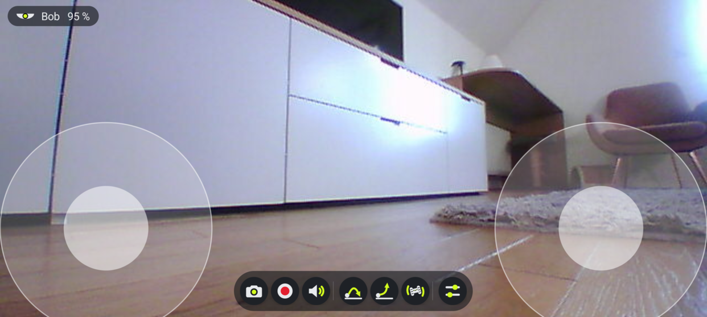

# Jolly

An open-source Android app (and a small Python script) to drive **Parrot Jumping** robots
(Jumping Sumo, Jumping Race, Jumping Night) on modern phones.

Parrot's official FreeFlight Jumping app only ships 32-bit native code, so it no longer installs
on 64-bit-only phones (`INSTALL_FAILED_NO_MATCHING_ABIS`). Jolly re-implements the drone's
open ARSDK3 protocol in pure Kotlin — no native code, no Parrot SDK.



> Not affiliated with, endorsed by or sponsored by Parrot. "Parrot", "Jumping Sumo",
> "Jumping Race" and "Jumping Night" are trademarks of their respective owners.

## Status

| Model | Status |
|---|---|
| Jumping Race Max | tested (firmware 2.1.77) |
| Jumping Sumo, other Jumping Race / Night | same protocol family, **untested** — reports welcome |

## Features

- Live video (640×480, ~15 fps), photos and MP4 recording to the phone's gallery
- Touch joysticks, jumps, postures, the 9 built-in animations
- Bluetooth gamepads: "Joysticks" and "Racing" presets, fully remappable, rumble
- Settings: max speed, turn sensitivity, progressive curve, disable jumps, kid mode, always-visible action bar
- Drone info: name, firmware, battery, Wi-Fi signal and channel, link quality
- Auto-reconnect, sound volume (saved by the drone), rename the drone (the Wi-Fi name follows after a reboot)

## Requirements

- Android 10 (API 29) or newer

## Build

```sh
cd android
./gradlew assembleDebug        # needs JDK 17+ and the Android SDK (compileSdk 35)
adb install -r app/build/outputs/apk/debug/app-debug.apk
```

## Python controller

`jumping.py` drives the robot from a computer (keyboard + video window). Join the drone's Wi-Fi first:

```sh
./jumping.py --probe   # connection test (prints battery)
./jumping.py           # video window + keyboard control
```

It runs with [uv](https://github.com/astral-sh/uv) (`pygame-ce` is installed automatically).

## Troubleshooting

- **The drone doesn't show up in the list.** Some units broadcast on 5 GHz, which a 2.4 GHz-only phone
  won't see. The Wi-Fi is also off while the robot is plugged in over USB.
- **"Connection refused" right after power-on.** The drone opens its control port a few seconds after
  its Wi-Fi appears; Jolly retries. A refusal that lasts usually means a flat or failing battery.

## Protocol notes

Jolly speaks ARSDK3, Parrot's open protocol ([Parrot-Developers](https://github.com/Parrot-Developers)).

**Handshake.** The drone is `192.168.2.1` on its own open Wi-Fi. Open TCP `44444` and send
`{"controller_type":"computer","controller_name":"…","d2c_port":54321}`; the reply is a null-terminated
JSON with `"status": 0` and `"c2d_port": 54321`. Then everything goes over UDP.

**Framing.** Each frame has a 7-byte header: `type u8, buffer id u8, seq u8, size u32 LE` (size includes
the header); several frames can share a datagram. Types: `1` ACK, `2` DATA, `3` low-latency (video),
`4` DATA_WITH_ACK. Each buffer has its own sequence counter (wraps at 256).

- Controller → drone buffers: `10` piloting, `11` acked commands, `12` emergency, `13` video ack.
- Drone → controller buffers: `127` events, `126` acked events, `125` video, `0` ping.
- Ack every `DATA_WITH_ACK` frame: type `1`, buffer `(id + 128) & 0xFF`, payload = the received seq.
- Answer a ping on buffer `0` with the same payload on buffer `1`.

**Commands** are `project u8, class u8, command u16 LE, args…`; enums are `i32 LE`, strings null-terminated.

| Command | Bytes | Notes |
|---|---|---|
| Piloting | `3/0/0` + `flag u8, speed i8, turn i8` | every 25 ms on buffer 10; flag 1 when moving; ±100 |
| Posture | `3/0/1` + `i32` | 0 standard, 1 jumper, 2 kicker |
| Jump | `3/2/3` + `i32` | 0 long, 1 high |
| Animation | `3/2/4` + `i32` | 1 spin, 2 tap, 3 slowshake, 4 metronome, 5 ondulation, 6 spinjump, 7 spintoposture, 8 spiral, 9 slalom |
| Video on/off | `3/18/0` + `u8` | |
| Volume | `3/12/0` + `u8` | 0–100, saved by the drone |
| Rename | `0/2/2` + string | the Wi-Fi name follows after a reboot |
| All states / settings | `0/4/0`, `0/2/0` | the drone replies with its state / product info |
| Date / time | `0/4/1` + `"YYYY-MM-DD"`, `0/4/2` + `"THHMMSS+ZZZZ"` | sent on connect |

| Event | Bytes | Meaning |
|---|---|---|
| Battery | `0/5/1` + `u8` | percent |
| Wi-Fi RSSI | `0/5/7` + `i16` | dBm |
| Name / version | `0/3/2` + string, `0/3/3` + 2 strings | SSID; firmware and hardware |
| Posture | `3/1/0` + `i32` | 0 standard, 1 jumper, 2 kicker, 3 stuck, 4 unknown |
| Alert | `3/1/1` + `i32` | 0 none, 1 critical battery, 2 low battery |
| Speed | `3/1/2` + `i8, i16` | real speed, `-32768` = unknown |
| Disconnection | `0/1/0` | sent before a shutdown on flat battery |

**Video** (ARStream v1) arrives on buffer 125: `frame u16, flags u8, fragment u8, fragments u8`, then a
JPEG chunk; each frame is a 640×480 JPEG. Ack on buffer 13 with `frame u16, high u64, low u64`
(bit n of low = fragment n < 64, high = fragment n − 64).

**Android.** The drone's Wi-Fi has no internet, so Android drops it if joined from the system settings.
Jolly requests it with `WifiNetworkSpecifier` (no `INTERNET` capability) and binds its sockets to that
network. Logs: `adb logcat -s Jolly JumpingProto`.

## License

[GPL-3.0-or-later](LICENSE).
